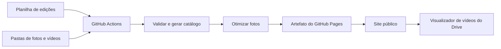

# Aldeia MIX

Site da Aldeia MIX, com informações para visitantes e expositores, logo SVG animada e uma galeria de edições alimentada por Google Drive e Google Sheets.

## Acessos

| Recurso | Link |
| --- | --- |
| Site | [aldeiamix.inspira.dev.br](https://aldeiamix.inspira.dev.br/) |
| Galeria | [Edições da Aldeia](https://aldeiamix.inspira.dev.br/edicoes.html) |
| Instagram | [@aldeiamixx](https://www.instagram.com/aldeiamixx/) |
| Biblioteca de mídias | [Pasta Aldeia Mix no Drive](https://drive.google.com/drive/folders/1HskEIFh64u0phtkLSJ97Ki3L7uRpRrJb) |
| Cadastro de eventos | [Planilha Edições Aldeia MIX](https://docs.google.com/spreadsheets/d/1D3cqpvJzfX5owavS9Sco1Qpt7SO_xa4rSlsNdRX88pk/edit) |
| Publicação | [GitHub Actions](https://github.com/coletivo-inspira/aldeiamix/actions) |

## Estado da integração

A interface e a página Edições estão publicadas. A planilha está criada, com as abas **Edições** e **Como usar**.

**A sincronização automática depende da configuração da conta de serviço Google.** Na entrega inicial, essa conexão ainda está pendente e o site apresenta uma biblioteca vazia, sem eventos fictícios. Depois de configurar e validar o acesso, ative `DRIVE_SYNC_ENABLED=true`.

O Instagram funciona como link para o perfil. O site não importa publicações, comentários ou mensagens do Instagram.

## Funcionalidades

- Logo SVG estática no menu e animada na página inicial, com repetição ao clicar.
- Navegação para horários, localização, edições e cadastro de interesse de expositores.
- Contato por WhatsApp sem exibir o número no botão e acesso ao Instagram.
- Destaque da edição realizada mais recente, com até seis fotos.
- Página de edições em ordem de data, com endereços individuais como `edicoes.html?id=identificador`.
- Carrossel com avanço a cada cinco segundos, controles de anterior/próxima, gesto de deslizar e pausa.
- Pausa automática durante interação, quando o carrossel sai da tela, quando a aba fica oculta e com preferência por movimento reduzido.
- Ampliação de fotos em uma janela que pode ser fechada com `Esc`.
- Vídeos carregados somente ao clicar, pelo visualizador do Drive, com link alternativo.

## Como cadastrar uma edição

### 1. Organize os arquivos no Drive

Na biblioteca, crie uma subpasta para cada evento. Coloque as mídias diretamente na pasta da edição, sem atalhos.

Exemplo de organização — nomes ilustrativos, não eventos cadastrados:

```text
Aldeia Mix/
├── Edições Aldeia MIX                 # Planilha de cadastro
└── AAAA-MM-DD - Nome do evento/
    ├── 01-chegada.jpg
    ├── 02-gastronomia.png
    ├── 03-encontros.webp
    └── 04-resumo.mp4
```

| Mídia | Formatos | Tratamento |
| --- | --- | --- |
| Fotos | JPEG, PNG e WebP; até 25 MiB por arquivo | Conversão para WebP, lado máximo de 1920 px, correção de orientação e remoção de metadados EXIF |
| Vídeos | MP4 | Reprodução pelo Drive; o arquivo não é copiado para o site |

As mídias são ordenadas pelo nome. Use prefixos `01-`, `02-` para controlar a sequência. Outros formatos e atalhos são ignorados. Subpastas internas não são percorridas para buscar mídias.

Vídeos precisam estar disponíveis para **qualquer pessoa com o link**, com acesso de leitura. A conta de serviço deve conseguir ler a pasta e os arquivos.

### 2. Preencha a planilha

Na aba **Edições**, acrescente uma linha por evento. Preserve o nome da aba e os cabeçalhos da primeira linha, nesta ordem:

| Coluna | Como preencher |
| --- | --- |
| `id` | Identificador único e estável, com letras minúsculas, números e hífens. Exemplo: `feira-outubro`. Não use espaços ou acentos. |
| `publicar` | `SIM` para incluir; `NÃO` ou vazio para manter fora do catálogo. |
| `nome` | Nome do evento exibido no site. Obrigatório quando publicado. |
| `data` | Data real do evento, exibida como `AAAA-MM-DD`. Obrigatória quando publicado. |
| `descrição` | Texto opcional sobre a edição. Quebras de linha são preservadas; HTML não é executado. |
| `pasta` | Link da subpasta do evento dentro da biblioteca. Não use o link da pasta principal. |
| `capa` | Link de uma foto da própria edição. Opcional; em branco, usa a primeira foto por ordem de nome. |

Linhas completamente vazias são ignoradas. IDs duplicados entre edições marcadas para publicação, datas inválidas, capas de outra pasta ou pastas fora da biblioteca interrompem a atualização.

A interface mostra somente eventos com data igual ou anterior ao dia atual em **America/Sao_Paulo**. A data futura oculta o evento na interface, mas não funciona como controle de privacidade: se estiver marcado `SIM`, seus dados e fotos podem integrar os arquivos públicos gerados. Para manter uma edição em rascunho, use `NÃO`.

### 3. Publique e revise

Com a conexão Google ativa, o site busca alterações a cada hora, no minuto 23. O GitHub pode atrasar execuções agendadas.

Para antecipar a publicação:

1. Abra **Actions → Publish GitHub Pages** no repositório.
2. Selecione **Run workflow**, usando a branch `main`.
3. Aguarde a conclusão com sucesso.
4. Abra a página Edições e confira os registros.

Para ocultar um evento, altere `publicar` para `NÃO`. Para remover uma mídia, retire-a da pasta. A mudança entra no site após a próxima publicação bem-sucedida; alterar o Drive não remove imediatamente as cópias já publicadas.

## Ativar a conexão Google (pendente)

### Preparar o acesso

1. Crie ou escolha um projeto no Google Cloud.
2. Habilite **Google Drive API** e **Google Sheets API**.
3. Crie uma conta de serviço exclusiva para essa integração, sem atribuir papéis administrativos no projeto.
4. Compartilhe a pasta da biblioteca com o e-mail dessa conta, como **Leitor**. Confira o acesso à planilha e às subpastas. Não conceda delegação de domínio.
5. Crie uma chave JSON para essa conta de serviço.

A aplicação solicita apenas os escopos `drive.readonly` e `spreadsheets.readonly`. O acesso concedido à conta deve se limitar à biblioteca necessária.

### Configurar o GitHub

Em **Settings → Secrets and variables → Actions**, cadastre:

| Tipo | Nome | Valor |
| --- | --- | --- |
| Secret | `GOOGLE_SERVICE_ACCOUNT_JSON` | Conteúdo integral da credencial JSON da conta de serviço |
| Variable | `DRIVE_SYNC_ENABLED` | `true`, após preparar o acesso |

Não coloque a chave no HTML, no repositório, na planilha ou em mensagens. O segredo é disponibilizado apenas durante a execução do importador.

Os IDs públicos da biblioteca e da planilha ficam em [`library.json`](library.json). Se substituir esses recursos, atualize esse arquivo e confira o acesso da conta de serviço.

Execute o workflow manualmente e confirme que a etapa **Build library** leu o catálogo sem erros. Um deploy no modo vazio não comprova a conexão com o Drive.

### Pausar sem apagar a galeria

Depois da primeira sincronização, mantenha `DRIVE_SYNC_ENABLED=true`. Para pausar as publicações, desative o workflow no GitHub Actions.

**Não remova a variável para pausar.** Quando ela não é `true`, execuções por push ou acionamento manual publicam a biblioteca vazia de preparação. As execuções agendadas ficam suspensas nesse modo.

Com a sincronização ativa, falhas de configuração, leitura ou validação interrompem o processo antes do deploy, preservando a versão pública anterior.

## Arquitetura



O site é estático: HTML, CSS e JavaScript. Python executa a importação durante a publicação. Não há servidor de aplicação ou credencial Google no navegador do visitante.

O frontend utiliza Tailwind via CDN, Font Awesome e Google Fonts. Fotos otimizadas e o catálogo são servidos pelo próprio site; vídeos dependem da disponibilidade e das permissões do Drive.

### Estrutura do projeto

```text
index.html                  Página inicial e logo animada
edicoes.html                Lista e detalhe das edições
logo-aldeia.svg              Logo vetorial estática
assets/site.css             Estilos da navegação e galeria
assets/editions.js           Catálogo, carrossel, fotos ampliadas e vídeos
data/editions.json          Catálogo vazio para desenvolvimento inicial
library.json                IDs da biblioteca e da planilha
scripts/sync_drive.py        Importador e gerador do site
tests/                      Testes do importador e seleção de edições
requirements.txt            Dependências Python
package.json                Configuração JavaScript e comando de teste
.github/workflows/pages.yml Validação e publicação
_site/                      Saída gerada; não versionada
```

### Catálogo público

O build gera `_site/data/editions.json` com:

- `version`: versão do formato, atualmente `1`.
- `updatedAt`: data/hora da geração; ausente no modo vazio inicial.
- `editions`: lista de edições com `id`, `name`, `date`, `description`, `cover` e `media`.
- Fotos: `id`, `name`, `type: "image"`, `src`, `width`, `height` e `alt`.
- Vídeos: `id`, `name`, `type: "video"`, `preview` e `url`.

`cover` contém a foto escolhida ou `null` quando não há fotos. Uma edição só com vídeos é válida. Uma edição sem mídias mostra uma mensagem de registros em breve.

O importador lê todas as páginas de resultados da pasta, valida sua ancestralidade e recria a saída. Imagens originais e credenciais não entram no histórico Git; fotos otimizadas ficam no artefato publicado.

## Desenvolvimento local

Use **Python 3.12** e **Node.js 22**, versões usadas no workflow. Os comandos abaixo devem ser executados na raiz deste repositório.

### Instalar e testar

```sh
python3 -m venv .venv
source .venv/bin/activate
python -m pip install -r requirements.txt
python -m unittest discover -s tests -v
node --test tests/catalog.test.mjs
```

No Windows, ative o ambiente com `.venv\Scripts\Activate.ps1`. Não inclua `.venv` em commits. Os testes JavaScript também podem ser executados com `npm test`; não precisam de instalação de pacotes npm.

### Visualizar sem credenciais

```sh
python scripts/sync_drive.py --bootstrap-empty
python -m http.server 8765 --directory _site
```

Abra [localhost:8765](http://localhost:8765/). Esse modo gera a interface com catálogo vazio; não consulta o Google nem testa autenticação.

### Validar a biblioteca real

Disponibilize `GOOGLE_SERVICE_ACCOUNT_JSON` no ambiente local por um mecanismo seguro, sem registrar o conteúdo em comandos compartilhados ou logs. Depois execute:

```sh
python scripts/sync_drive.py
python -m http.server 8765 --directory _site
```

A saída padrão é `_site`. O argumento `--output` altera esse destino, mas o script remove a pasta de saída existente antes de reconstruí-la. Use apenas uma pasta dedicada a arquivos gerados.

## Testes e verificações

Os testes automatizados cobrem validação de linhas e datas, IDs duplicados, limites da biblioteca, inclusão e remoção de mídias, escolha de capa, vídeo, falha de leitura e seleção de edições realizadas.

Antes de publicar mudanças de interface, confira também:

- Layout no celular e desktop, sem rolagem horizontal inesperada.
- Navegação por teclado, foco visível e fechamento da foto ampliada com `Esc`.
- Carrossel com uma ou várias fotos, pausa, avanço manual e movimento reduzido.
- Biblioteca vazia, edição sem fotos, endereço de edição inexistente e erro no carregamento do catálogo.
- Vídeo carregado somente após clicar e funcionamento do link alternativo.

Os testes locais usam dados sintéticos. Eles não comprovam acesso real às APIs do Google; essa verificação exige a credencial configurada e uma execução de importação bem-sucedida.

## Publicação

O workflow **Publish GitHub Pages** executa em:

- Push na branch `main`.
- Acionamento manual pelo GitHub Actions.
- Agendamento horário, quando `DRIVE_SYNC_ENABLED=true`.

A sequência é: instalar dependências, executar testes Python e JavaScript, construir a biblioteca, enviar o artefato e publicar no GitHub Pages. Um erro anterior ao deploy impede a substituição do site.

O workflow publica somente os arquivos gerados em `_site`, não todo o repositório. O domínio do site é configurado no GitHub Pages.

## Solução de problemas

| Sintoma | O que verificar |
| --- | --- |
| Site continua sem edições | Conexão ativa, workflow concluído, `publicar=SIM` e data do evento não futura. |
| Atualização não começou | Variável `DRIVE_SYNC_ENABLED`, agendamento do GitHub e workflow habilitado. Execute manualmente para antecipar. |
| Erro de autenticação ou acesso | Secret válido, APIs habilitadas e compartilhamento da biblioteca com a conta de serviço. |
| Cabeçalhos inválidos | Nome da aba `Edições` e as sete colunas na ordem documentada. |
| Data rejeitada | Célula exibida como `AAAA-MM-DD` e data existente no calendário. |
| Pasta fora da biblioteca | Link de uma subpasta da biblioteca, sem atalhos para recursos externos. |
| Capa rejeitada | Link de uma foto JPEG, PNG ou WebP presente diretamente na pasta da edição. |
| Foto rejeitada | Formato suportado, arquivo íntegro e tamanho até 25 MiB. |
| Vídeo não abre | MP4 acessível para qualquer pessoa com o link e disponível no Drive. Teste o link alternativo. |
| Conteúdo antigo após alteração | Último workflow pode ter falhado; a versão anterior permanece até uma publicação bem-sucedida. |

## Manutenção

- Preserve os IDs das edições para manter os links individuais funcionando.
- Revise o compartilhamento de novas pastas e vídeos antes de publicar.
- Atualize e teste dependências periodicamente, mantendo compatibilidade com o workflow.
- Faça a rotação da credencial Google quando necessário e atualize o secret correspondente.
- Para restaurar código, reverta o commit e publique novamente. Isso não restaura arquivos removidos do Drive; a recuperação das mídias depende da biblioteca original.
